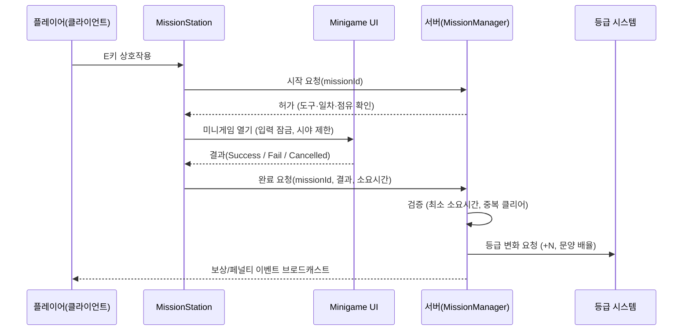

# King Maker — 미니게임(미션) 파트 개발 계획서

> 작성 기준일: 2026-09-29 (5주차 회의 직후)
> 담당: 미니게임(미션) 파트
> 엔진: Unity / 플랫폼: Windows(PC) / 시점: 1인칭 / 조작: 키보드 + 마우스

---

## 1. 문서 목적과 담당 범위

이 문서는 King Maker의 **미션 = 미니게임** 파트를 어떤 구조로, 어떤 순서로 개발할지 정리한 계획서다. 게임 전체 기획(등급·컷오프·시드포커·조커 등)은 다른 파트가 담당하므로, 여기서는 그 시스템들과 **미니게임이 맞닿는 인터페이스**만 다룬다.

| 구분 | 담당 범위 (O) | 연동만 필요 (△) |
|---|---|---|
| 미니게임 로직/UI | 개인·협동·특수·경쟁 미션 전부 | - |
| 미션 스테이션(맵 오브젝트) | 상호작용, 점유, 쿨다운, 일차 리셋 | 맵 배치 위치 |
| 보상/페널티 발생 | 결과 이벤트 발행, 등급 변화량 전달 | 실제 등급 계산(등급 시스템) |
| 도구(아이템) 조건 | 도구 보유 여부 체크 | 도구 획득/상점 |
| 네트워크 | 미션 결과 요청/검증 흐름 | 네트워크 프레임워크 자체 |
| 사운드/알림 페널티 | 소음·위치 공개 이벤트 발행 | 거리기반 음성채팅, HUD |

---

## 2. 기획 문서에서 뽑은 미니게임 관련 규칙

기획·프로젝트 내용·미션 문서에 흩어진 내용 중 미니게임 구현에 직접 영향을 주는 것만 모았다.

**게임 흐름 측면**
- 게임은 총 20분, 5분 × 4일차로 진행된다. 미니게임 1회 플레이 시간은 이 5분 안에서 여러 개를 돌릴 수 있어야 하므로 **개인 미션은 10~20초 내외**가 적정하다.
- 미션은 **플레이어별로 1일마다 리셋**되며, 한 번 클리어한 미션은 다음 날까지 재수행 불가.
- 미션 성공 시 등급 변화: +1, +2, ± (타인 등급을 올리거나 내리는 미션 포함).
- 메인 문양과 같은 카드를 가진 플레이어는 더 빠르게 성장 → **보상 배율 훅**이 필요.

**미션 분류 (미션 문서 기준)**
- 개인 미션 8~10개: 혼자 빠르게 해결, **도구가 있어야 수행 가능 + 조건**이 붙으면 좋음
- 협동/단체 미션 2~3개: 2명이 동시에 조작
- 고위험/특수 미션 2개: 보상이 크지만 시야 차단 또는 큰 소리 발생
- 경쟁 미션(아이디어): 에어하키, 테이블 축구 등 — 몰입 중 킬 위험이라는 긴장감 제공

**다른 시스템과의 연결점**
- 공용 미션을 일차 내 전부 클리어하면 등급 분포 공개 (예: 2등급 2명, 3등급 1명)
- 해당 일차 **개인 미션을 전부 클리어**하면 개인에게 힌트 제공 (시드포커 유불리 추정용)
- 개선 아이디어: 등급이 높을수록 미션 수행 시 페널티 (소음, 위치 공개, CCTV 기록, 알림, 조커 추적 용이)
- 개선 아이디어: 미션 성공 시 **점수 vs 정보** 선택
- 공격은 자신보다 낮은 등급만 가능 → 미니게임 중인 플레이어는 무방비 상태가 되는 것이 핵심 긴장 요소

---

## 3. 미니게임 설계 원칙

1. **짧고 명확하게**: 규칙을 5초 안에 이해할 수 있어야 한다. 1인칭 + 음성채팅 + 킬 위협 상황에서 복잡한 규칙은 재미가 아니라 스트레스가 된다.
2. **몰입 = 위험**: 미니게임 화면이 열려 있는 동안 주변 시야가 제한되도록 한다. 이것이 조커에게 킬 기회를 주는 게임 디자인 장치다.
3. **즉시 중단 가능**: 공격받거나 ESC를 누르면 언제든 미니게임을 취소하고 1인칭 조작으로 돌아와야 한다.
4. **데이터 기반 밸런싱**: 제한시간, 보상, 난이도 수치는 코드가 아닌 `ScriptableObject`에 두어 기획자가 직접 조정할 수 있게 한다.
5. **공통 프레임워크 우선**: 미니게임 10개 이상을 만들 것이므로, 1~2개를 만들기 전에 공통 구조부터 확정한다.

---

## 4. 공통 프레임워크 설계

### 4-1. 전체 흐름



### 4-2. 주요 클래스 구성

| 클래스 | 역할 |
|---|---|
| `MissionData` (ScriptableObject) | 미션 ID, 이름, 종류, 필요 도구, 보상량, 제한시간, 난이도 파라미터, 페널티 설정 |
| `MissionStation` (MonoBehaviour) | 맵에 배치되는 상호작용 오브젝트. 점유 상태, 하이라이트, 미니게임 호출 |
| `MinigameBase` (추상 클래스) | 모든 미니게임의 부모. 시작/취소/종료 이벤트 제공 |
| `MinigameController` | 현재 열린 미니게임 관리, 플레이어 입력·카메라 잠금/해제 |
| `MissionManager` (서버) | 플레이어별 일차 클리어 기록, 검증, 보상 요청, 일차 리셋 |
| `MissionProgressTracker` | 개인/공용 미션 전부 클리어 여부 판정 → 힌트·등급분포 공개 트리거 |

### 4-3. 코드 골격 (초안)

```csharp
public enum MissionType { Personal, Coop, HighRisk, Competitive }
public enum MinigameResult { Success, Fail, Cancelled }

[CreateAssetMenu(menuName = "KingMaker/MissionData")]
public class MissionData : ScriptableObject
{
    public string missionId;
    public string displayName;
    public MissionType type;
    public string requiredToolId;      // 비어 있으면 도구 불필요
    public int gradeReward = 1;        // 성공 시 등급 변화량
    public float timeLimit = 15f;      // 제한시간(초)
    public float minClearTime = 2f;    // 서버 검증용 최소 소요시간
    public int requiredPlayers = 1;    // 협동 미션은 2
    public GradePenalty[] penalties;   // 등급 구간별 페널티
    public GameObject minigamePrefab;
}

public abstract class MinigameBase : MonoBehaviour
{
    public event System.Action<MinigameResult> OnFinished;
    protected MissionData data;
    protected float elapsed;
    bool finished;

    public virtual void Begin(MissionData missionData)
    {
        data = missionData;
        elapsed = 0f;
        finished = false;
    }

    protected virtual void Update()
    {
        if (finished) return;
        elapsed += Time.deltaTime;
        if (elapsed >= data.timeLimit) Finish(MinigameResult.Fail);
    }

    public void Cancel() => Finish(MinigameResult.Cancelled);

    protected void Finish(MinigameResult result)
    {
        if (finished) return;
        finished = true;
        OnFinished?.Invoke(result);
    }
}
```

미니게임 하나를 새로 만들 때는 `MinigameBase`를 상속하고, 성공/실패 판정 시 `Finish()`만 호출하면 된다. 나머지(입력 잠금, 서버 통신, 보상)는 프레임워크가 처리한다.

### 4-4. 공통 처리 규칙

| 상황 | 처리 |
|---|---|
| 미니게임 도중 피격/사망 | 즉시 `Cancelled`, 보상 없음, 스테이션 점유 해제 |
| ESC 입력 | `Cancelled`, 같은 일차 내 재도전 가능 |
| 실패(`Fail`) | 재도전 허용 여부는 미션별 설정 (기본: 3초 쿨다운 후 재도전) |
| 이미 클리어한 미션 | 스테이션에 "오늘은 완료" 표시, 상호작용 불가 |
| 필요 도구 없음 | "○○가 필요합니다" 안내, 미니게임 열리지 않음 |
| 다른 플레이어가 점유 중 | 개인 미션은 1인 점유, 대기 불가 |
| 일차 종료(컷오프) | 진행 중인 미니게임 전부 강제 `Cancelled` |

### 4-5. 네트워크 방침

- 미니게임 **플레이 자체는 클라이언트 로컬**에서 처리한다. (카드 뒤집기, 마우스 드래그를 매 프레임 동기화할 필요 없음)
- **시작/완료만 서버 권한**으로 처리한다. 서버는 도구 보유, 일차 중복 클리어, 최소 소요시간(`minClearTime`), 스테이션 점유를 검증한다.
- 협동·경쟁 미션은 예외적으로 **상태 동기화가 필요**하다 (버튼 동시 입력 판정, 에어하키 퍽 위치). 이 두 종류는 일정 후반에 배치한다.
- 사용할 네트워크 프레임워크(Netcode for GameObjects, Photon Fusion 등)는 서버 담당과 확정 후 `MissionManager`의 RPC 부분만 맞춰 작성한다.

---

## 5. 미니게임 상세 명세

### 5-1. 개인 미션 (기획 확정 5종)

| # | 이름 | 장소 | 입력 | 규칙 | 성공 조건 | 제한시간(안) | 난이도 조절 파라미터 |
|---|---|---|---|---|---|---|---|
| P1 | 와인잔 닦기 | 바 | 마우스 드래그 | 잔 표면의 와인 얼룩을 문질러 지운다 | 얼룩 면적 95% 이상 제거 | 15초 | 얼룩 개수, 브러시 크기 |
| P2 | 카드 짝 맞추기 | 카지노 | 마우스 클릭 | 6장(3쌍)을 뒤집어 같은 카드끼리 맞춘다 | 3쌍 모두 매칭 | 20초 | 쌍 개수, 앞면 노출 시간 |
| P3 | 잭팟 숫자 맞추기 | 카지노 | 마우스 클릭 | 첫 칸만 랜덤, 2·3칸은 9 고정. 위/아래 버튼으로 첫 칸을 9로 맞춘다 (예: 7 9 9 → ▲ 2회) | 777/999 등 목표 숫자 일치 | 10초 | 랜덤 칸 수, 버튼 방향 제한 |
| P4 | CCTV 모니터 켜기 | CCTV실 | 마우스 홀드 | 꺼진 모니터에 표시되는 색과 같은 버튼을 3초간 누른다 | 올바른 버튼 3초 유지 | 12초 | 버튼 개수, 홀드 시간, 색 변경 여부 |
| P5 | 코르크 병 따기 | VIP룸 | 스페이스바 | 움직이는 바가 목표 구간 안에 들어왔을 때 스페이스 | 구간 안에서 입력 (1~3회) | 10초 | 바 속도, 구간 폭, 필요 성공 횟수 |

**구현 메모**
- P1은 `RenderTexture` 또는 텍스처 마스크에 브러시를 그리고, 일정 간격으로 투명 픽셀 비율을 샘플링해 진행률을 계산한다. 매 프레임 전체 픽셀 검사는 피한다.
- P3는 기획 예시상 난이도가 매우 낮으므로, 버튼 한 번 누를 때마다 숫자가 굴러가는 애니메이션(0.3초)을 넣어 체감 시간을 확보하는 것을 제안한다.
- P4는 홀드 중 버튼을 떼면 게이지 초기화. 오답 버튼 홀드 시 실패 처리할지 기획 확인 필요.
- P5는 기획 문서의 이미지(바 안에 코르크가 들어가는 형태)를 기준으로 UI 제작.

### 5-2. 개인 미션 (추가 후보 — 목표 8~10개를 채우기 위함)

| # | 이름(안) | 출처 | 한 줄 설명 |
|---|---|---|---|
| P6 | 규칙 찾기 | 미션 문서 | 숫자 카드 나열에서 짝수/홀수 등 규칙에 맞는 카드만 고르기 |
| P7 | 칩 정리 | 신규 제안 | 색깔별 카지노 칩을 같은 색 트레이에 드래그 |
| P8 | 룰렛 멈추기 | 신규 제안 | 돌아가는 룰렛을 지정 칸에서 멈추기 (타이밍형, P5와 차별화 필요) |
| P9 | 금고 다이얼 | 신규 제안 | 힌트 숫자를 보고 다이얼 3자리 맞추기 |
| P10 | 카드 셔플 순서 기억 | 신규 제안 | 섞이는 카드 중 특정 카드 위치 추적 |

> 카지노/바 테마가 이미 잡혀 있으므로 후보도 같은 테마 안에서 제안했다. 확정 여부는 기획 회의에서 결정.

### 5-3. 협동 미션 (2~3개)

| # | 이름 | 규칙 | 핵심 구현 포인트 |
|---|---|---|---|
| C1 | 동시 버튼 | 떨어진 두 스테이션에서 2명이 0.5초 이내에 동시에 버튼을 누른다 | 서버에서 두 입력 타임스탬프 비교 |
| C2 | 함께 틀린 그림 찾기 | 두 사람이 각자 다른 그림을 보고 음성으로 소통해 차이점을 찾는다 | 두 클라이언트에 서로 다른 이미지 제공, 정답 클릭은 서버 집계 |

**설계 포인트**: 협동 미션은 "상대가 조커일지도 모르는데 등을 맡겨야 하는" 심리전 장치다. 두 스테이션을 **서로 시야가 안 닿는 위치**에 배치하면 긴장감이 커진다. 조커도 협동 미션에 참여 가능하게 둘지(위장 수단) 기획 확인 필요.

### 5-4. 고위험/특수 미션 (2개)

| # | 이름 | 규칙 | 리스크 |
|---|---|---|---|
| H1 | 눈 가리고 카드 맞추기 | 화면이 거의 암전된 상태에서 카드 앞/뒷면을 추측(운 요소) | 수행 중 **시야 차단**, 보상 +2~+3 |
| H2 | 금고 털기(안) | 소리가 나는 장치를 다루는 미니게임 | 성공/실패 시 **맵 전체에 큰 소리** + 위치 일시 공개 |

### 5-5. 경쟁 미션 (아이디어 단계)

- 에어하키 / 테이블 축구 형태의 1:1 대결, 승자에게 더 큰 보상
- 기획 문서의 의도대로 "경쟁에 몰입한 순간이 곧 킬 타이밍"이 되는 구조
- 퍽·공의 물리 동기화가 필요해 **구현 난이도가 가장 높다**. 일정상 마지막 단계에 두고, 시간이 부족하면 턴제 대결(예: 하이/로우 카드 맞추기)로 축소하는 대안을 준비한다.

---

## 6. 보상·페널티 연동 설계

### 6-1. 보상 계산 (미니게임 파트에서 발행하는 값)

```
최종 등급 변화 = MissionData.gradeReward × 문양 배율(메인 문양 일치 시) 
```

미니게임 파트는 `gradeReward`와 "메인 문양 적용 대상 여부"만 이벤트로 넘기고, 실제 반올림·상한 처리는 등급 시스템 담당이 결정한다.

### 6-2. 등급 구간별 페널티 (개선 아이디어 2번 구현안)

| 등급 구간(안) | 페널티 | 구현 방식 |
|---|---|---|
| 낮음 | 없음 | - |
| 중간 | 미션 완료 시 주변 플레이어에게 효과음 | 3D 사운드, 반경 설정 |
| 높음 | 미션 수행 중 미니맵/HUD에 위치 3초 공개 | `OnMissionStarted` 이벤트 → HUD 담당 연동 |
| 최상위 | CCTV 기록 (CCTV실에서 열람 가능) | 미션 로그를 서버에 저장 |

`MissionData.penalties`에 구간별로 넣어두면, 같은 코드로 미션마다 다른 페널티를 줄 수 있다.

### 6-3. 점수 vs 정보 선택 (개선 아이디어 3번)

미니게임 성공 직후 선택 창을 띄운다.
- **점수**: 등급 +N
- **정보**: 무작위 1명의 등급 구간 확인 (예: "B는 8등급 이상")

선택 UI 자체는 미니게임 파트에서 만들고, 정보 내용 생성은 등급 시스템 쪽 API를 호출한다.

### 6-4. 전체 클리어 보상 트리거

- 개인 미션 전부 클리어 → `OnAllPersonalMissionsCleared(playerId)` 발행 → 힌트 시스템
- 공용 미션 전부 클리어 → `OnAllSharedMissionsCleared(day)` 발행 → 등급 분포 공개

---

## 7. 개발 일정 (안)

> 주차는 팀 회의 주차 기준. 시험 기간은 팀 일정에 맞춰 버퍼로 조정한다.

| 주차 | 기간(안) | 목표 | 산출물 |
|---|---|---|---|
| 6주차 | 9/29 ~ 10/5 | 공통 프레임워크 | `MinigameBase`, `MissionData`, `MissionStation`, 입력/카메라 잠금, 테스트 씬 |
| 7주차 | 10/6 ~ 10/12 | 개인 미션 1차 | P2 카드 짝 맞추기, P3 잭팟, P5 코르크 (로직이 단순한 것부터) |
| 8주차 | 10/13 ~ 10/19 | 개인 미션 2차 | P1 와인잔, P4 CCTV, 도구 조건 체크 |
| 9주차 | 10/20 ~ 10/26 | 버퍼 / 시험 기간 | 버그 수정, 1차 사내 플레이테스트 |
| 10주차 | 10/27 ~ 11/2 | 네트워크 연동 | 서버 검증 흐름, 일차 리셋, 클리어 기록 동기화 |
| 11주차 | 11/3 ~ 11/9 | 협동 미션 | C1 동시 버튼, C2 틀린 그림 찾기 |
| 12주차 | 11/10 ~ 11/16 | 특수 미션 + 페널티 | H1, H2, 등급 구간별 페널티, 점수 vs 정보 선택 |
| 13주차 | 11/17 ~ 11/23 | 추가 개인 미션 | P6~P8 중 기획 확정분 |
| 14주차 | 11/24 ~ 11/30 | 경쟁 미션 (선택) | 에어하키 또는 축소안 |
| 15주차 | 12/1 ~ 12/7 | 밸런싱·폴리싱 | 제한시간/보상 조정, 사운드·이펙트 |

**우선순위 (일정이 밀릴 경우 뒤에서부터 제외)**
1. 공통 프레임워크 + 개인 미션 5종 + 네트워크 검증 ← 최소 시연 가능 범위
2. 협동 미션 1종
3. 특수 미션 + 페널티
4. 추가 개인 미션
5. 경쟁 미션

---

## 8. 테스트 및 밸런싱 계획

**기능 테스트 체크리스트 (미니게임마다)**
- [ ] 제한시간 초과 시 실패 처리
- [ ] ESC 취소 후 1인칭 조작 정상 복귀 (마우스 커서 잠금 포함)
- [ ] 미니게임 도중 피격 시 즉시 종료
- [ ] 같은 일차 재클리어 불가, 다음 일차 리셋 확인
- [ ] 도구 없을 때 진입 차단
- [ ] 두 명이 동시에 같은 스테이션 접근 시 한 명만 진입
- [ ] 일차 종료 시 강제 종료

**밸런싱 기준 (측정 후 조정)**
- 개인 미션 평균 클리어 시간: 10~20초 목표
- 첫 시도 성공률: 개인 70~85%, 특수 40~60%
- 1일차(5분) 동안 이동 포함 수행 가능한 미션 수를 측정해 컷오프(4등급) 도달 가능성과 맞춰본다
- 테스트 시 미션별 소요시간·성공률을 CSV 로그로 남겨 수치 조정 근거로 사용

---

## 9. 리스크와 대응

| 리스크 | 영향 | 대응 |
|---|---|---|
| 미니게임 수가 많아 일정 부족 | 목표 8~10개 미달 | 공통 프레임워크로 제작 비용 최소화, 우선순위 순으로 제작 |
| 협동/경쟁 미션 동기화 난이도 | 일정 지연 | 후반 배치, 턴제 등 축소안 준비 |
| 미니게임이 너무 쉬워 긴장감 부족 | 성장 속도 과다 | 난이도 파라미터를 SO로 분리해 빠르게 조정 |
| 미니게임이 너무 어려워 1인칭 조작과 충돌 | 재미 저하 | 규칙 5초 이해 원칙, 플레이테스트 피드백 반영 |
| 클라이언트 조작으로 부정 클리어 | 밸런스 붕괴 | 서버 검증(최소 소요시간, 중복 클리어, 점유) |
| 등급 시스템 기획 변경 | 보상 로직 수정 | 미니게임은 보상량만 발행, 계산은 등급 시스템에 위임 |

---

## 10. 팀 확인이 필요한 사항

기획 문서들 사이에 값이 서로 다른 부분이 있어, 미니게임 보상 수치를 정하기 전에 확인이 필요하다.

1. **시작 등급**: "2등급에서 시작"(기획·프로젝트 내용)과 "모든 플레이어가 1에서 시작"(9/28 회의록)이 다르다.
2. **최고 등급 수치**: 프로젝트 내용은 K = 13, 기획의 등급 규칙은 10 이후 3단계씩(J=13, Q=16, K=19)으로 되어 있다. 보상 +1이 의미하는 크기가 달라지므로 미션 보상량 설계에 직접 영향이 있다.
3. **미션 보상 단위**: "포인트 획득"과 "등급 상승"이 혼용되어 있다. 포인트가 별도 재화인지, 곧 등급인지 확인 필요.
4. **공용 미션의 정의**: 협동 미션과 같은 것인지, 모든 플레이어가 공유하는 별도 미션 목록인지.
5. **조커의 미션 수행**: 조커도 미션을 해서 등급을 올리는지 (공격하려면 상대보다 높은 등급이 필요하므로 조커에게도 필요해 보임), 조커가 K가 되면 조커 승(9/28 회의)이므로 조커용 보상 제한이 있는지.
6. **타인 등급을 올리거나 내리는 미션**: 9/28 회의에서 "포인트를 남에게 적용 X"로 정해졌는데, 초기 기획의 ± 미션은 폐기된 것인지.
7. **도구 획득 경로**: 미션용 도구를 맵에서 줍는지, 상점에서 사는지.
8. **네트워크 프레임워크 확정 시점**: 10주차 네트워크 연동 전까지 필요.
