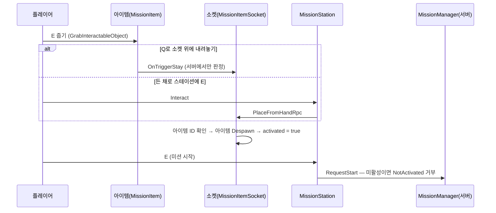

# King Maker — 미니게임(미션) 파트 개발 계획서 (3차 기획 반영)

> 작성 기준일: 2026-11-10 (3차 기획서 반영)
> 담당: 미니게임(미션) 파트
> 이전 문서: `KingMaker_미니게임_개발계획서.md` (9/29, 1차 계획)
> 엔진: Unity 6 + Netcode for GameObjects / 플랫폼: Windows(PC) / 1인칭 / 키보드 + 마우스

---

## 1. 문서 목적과 담당 범위

3차 기획서에서 바뀐 미션 규칙을 정리하고, **지금까지 만든 것(1차 계획 6~11주차 분량)** 위에서 남은 미션을 어떤 순서로 만들지 다시 계획한다.
블라인드 드롭, PT 정보판, 정체 조사권, 전투, 승리 판정은 다른 파트 담당이며, 이 문서는 그 시스템과 미션이 **맞닿는 지점만** 다룬다.

| 구분 | 담당 (O) | 연동만 (△) |
|---|---|---|
| 미니게임 로직/UI | 개인 10종, 협동 5종, 도박 3종, Q 전용 미션 | - |
| 미션 스테이션·아이템 장착 | 스테이션, 아이템 소켓(올려놓으면 활성화), 일차 리셋 | 맵 배치 위치, 줍기/버리기(`GrabInteractableObject`) |
| 보상/배팅 결과 | PT 변화량 발행, 도박 성공 확률 계산 | 실제 PT 반영·탈락 처리 |
| 협동 미션 클리어 | 클리어 이벤트 발행 | PT 정보판 해금(`AnonymousScoreboardManager`) |
| 일차 | 일차 시작/종료 시 미션 리셋·강제 종료 | 일차 타이머(`GameTimeManager`) |

---

## 2. 3차 기획서에서 바뀐 점 (미션 관련)

| 항목 | 1차 계획 (9/29) | 3차 기획서 | 미션 파트 영향 |
|---|---|---|---|
| 단위 | 등급 | **PT** (1 PT 시작, K = 19 PT) | 보상 수치를 PT로 표기. 코드(`cardGrade`)는 그대로 |
| 일차 구성 | 5분 × 4일 | 5분 × 3일, 미션 시간은 **일차당 3분 30초** | 개인 미션 1회 10~20초 원칙 유지 |
| 미션 분류 | 개인 / 협동 / 고위험 / 경쟁 | 개인 / 협동(공용) / **특수(도박)** / **Q 전용** | 고위험·경쟁 → 도박으로 대체, Q 전용 신규 |
| 미션 활성화 | "도구 보유" 체크 | **맵에서 아이템을 찾아 올려놓으면 활성화** | 아이템 소켓 시스템으로 교체 (4장, 구현 완료) |
| 보상 | 전부 +1 | 미션마다 +1 / +2 / +3 | MissionData 수치 변경 (구현 완료) |
| 협동 클리어 | 등급 분포 공개 | **익명 PT 정보판 해금** (해당 일차 동안) | 클리어 이벤트 → 정보판 파트 연동 |
| 개인 미션 전부 클리어 | 힌트 제공 | (언급 없음) → **도박 성공 확률 +1%/개** | 개인 미션 클리어 수 집계를 도박에 연결 |
| 페널티 | 등급 구간별 소음/위치 공개 | (언급 없음) | 보류. 코드(`GradePenalty`)는 남겨둠 |

---

## 3. 현재 구현 상태 (2026-11-10)

| 구분 | 상태 | 비고 |
|---|---|---|
| 공통 프레임워크 | ✅ | `MinigameBase`, `MinigameController`, `MissionData`, `MissionStation` |
| 서버 검증 | ✅ | `MissionManager` — 일차/중복/점유/쿨다운/거리/최소 소요시간 |
| 일차 리셋, 사망 시 강제 종료 | ✅ | `ServerStartDay`, `ServerEndDay`, `ServerCancelFor` |
| CSV 로그 | ✅ | `MissionLogger` |
| P1 와인잔 닦기 | ✅ | 아이템(와인잔) 장착 연결 |
| P2 카드 짝 맞추기 | ✅ | 아이템(카드 덱) 장착 연결 |
| P3 잭팟 숫자 맞추기 | ✅ | 3차 규칙(회전 중 STOP)으로 수정 완료 |
| P4 CCTV 모니터 | ✅ | 마우스(ComputerMouse) 스테이션 |
| P5 코르크 따기 | ✅ | 와인병(WineBottle) 스테이션 |
| 아이템 장착 시스템 | ✅ (이번 작업) | `MissionItem`, `MissionItemSocket`, 프리팹 생성 메뉴 |
| P6 키보드 조작 / P9 전구 | ✅ (스테이션 미배치) | 미니게임·데이터 완료. P6 오락기계 위치, P9 전구 모델 필요 |
| P7 네온 / P8 청소 / P10 금고 | ✅ | 미니게임·데이터 완료, MissionTest 배치 |
| 협동 기반 (`CoopSession`) | ✅ | `MissionManager.Coop.cs` — 서버 권한 판정, 자리 상태 NetworkList 동기화, `CoopMissionCleared` 이벤트 |
| C1 라디오 끄기 | ✅ | `CoopMissionData`(SyncAction), `CoopSlotVisual`(소리·불빛), `Station_C1_Radio`(스피커 모델 대체) |
| C2 산수 | ✅ | SumItems 모드, `CoopSumBoard`(목표 숫자·패널 생성), `Item_NumberPanel_1~9` |
| 공유 미니게임 구조 | ✅ | `CoopGameLogic`(서버 판정) + `CoopMinigameBase`(화면) + `CoopMsg`, 자리 번호(`coopSeat`) |
| C3 카드(고급) / C4 당구 / C5 농구 | ✅ | `CoopCards*`, `AimPower*`(C4·C5 공용) |
| 도박 G1 동전 / G2 하이-로우 | ✅ | `GambleConfig`, `BetPanel`, `MissionManager.Gamble.cs` (난수·등급은 서버만) |
| G3 카드 대결 | ✅ | `CardDuel*` (공유 미니게임 구조 재사용) |
| Q 전용 블라인드 사격 | ✅ | `QShoot*` (Q 자리 16 PT 이상, 성공 시 19 PT) |
| 실제 2인(호스트+클라이언트) 플레이 | ⬜ | 서버 판정은 가상 클라이언트로 검증 완료, 실제 2창 테스트 필요 |

---

## 4. 아이템 장착 시스템 (이번 작업)

3차 기획서: "맵에서 와인잔을 찾아 특정 테이블 위에 놓으면 활성화".
`Assets/Objects/IsTrigger`의 모델 5종을 아래처럼 사용한다.

| 모델 | 용도 | 미션 | 활성화 방식 |
|---|---|---|---|
| WineGlass | 줍는 아이템 + 테이블 위 장착 모델 | P1 와인잔 닦기 (+2) | 바 테이블에 올려놓기 |
| CardDeck | 줍는 아이템 + 장착 모델 | P2 카드 짝 맞추기 (+2) | 포커 테이블에 올려놓기 |
| JackPotLever | 줍는 아이템 + 장착 모델 | P3 잭팟 (+2) | 레버 빠진 오락 기계에 장착 |
| ComputerMouse | 스테이션 모델 | P4 CCTV (+1) | 아이템 불필요 |
| WineBottle | 스테이션 모델 | P5 코르크 (+1) | 아이템 불필요 |

### 4-1. 흐름

### 4-2. 규칙

- 장착 상태는 **스테이션 공용**이다. 한 명이 올려두면 그 일차 동안 누구나 수행 가능 (클리어 기록은 기존처럼 플레이어별).
- 다음 일차가 되면 소켓은 비활성으로 돌아가고, 아이템이 `respawnPoints` 중 한 곳에 다시 생성된다.
- 들고 있는 아이템(트리거 상태)이 소켓을 스쳐도 장착되지 않는다. 내려놓거나 E로 장착해야 한다.

### 4-3. 사용 방법 (Unity)

1. 메뉴 `KingMaker/Missions/Create IsTrigger Mission Prefabs` 실행
   - `Prefebs/MissionItems/Item_CardDeck`, `Item_JackPotLever` 생성, 기존 `Prefebs/WineGlass`에 `MissionItem` 추가
   - `Prefebs/MissionStations/Station_P1~P5` 생성
2. 스테이션을 맵의 테이블/기계 위에 배치하고, 아이템을 맵 곳곳에 배치
3. 각 소켓(`DropZone`)의 `respawnPoints`에 다음 일차 재생성 위치 지정
4. `KingMaker/Missions/Assign Station IDs` 실행
5. 아이템 프리팹이 NetworkManager의 Network Prefabs 목록에 들어갔는지 확인, 손에 든 위치는 `gripOffset/gripEuler`로 조정

---

## 5. 남은 미니게임 명세

### 5-1. 개인 미션 (3차 기획서 10종)

| # | 이름 | 보상 | 위치 / 활성화 | 조작 | 상태 |
|---|---|---|---|---|---|
| P1 | 와인잔 닦기 | +2 | 와인잔 → 바 테이블 | 마우스 드래그로 얼룩 지우기 | ✅ |
| P2 | 카드 짝 맞추기 | +2 | 카드 덱 → 포커 테이블 | 6장(3쌍) 클릭 | ✅ |
| P3 | 잭팟 숫자 맞추기 | +2 | 레버 → 오락 기계 | 회전하는 첫 숫자를 상단 버튼으로 멈춰 맞추기 (2·3번째 9 고정) | ✅ |
| P4 | CCTV 모니터 켜기 | +1 | CCTV실 키보드/마우스 | 모니터 색과 같은 버튼 3초 홀드 | ✅ |
| P5 | 코르크 마개 따기 | +1 | 주점 와인병 | 바늘이 칸에 들어올 때 Space | ✅ |
| P6 | 키보드 조작 게임 | +1 | 오락실 오락기계 | 화면에 뜬 방향키 순서대로 입력 | ✅ 미니게임 |
| P7 | 네온사인 선 연결 | +1 | 벽 네온 배선함 | 색이 같은 단자끼리 드래그 연결 | ✅ |
| P8 | 청소 게임 | +1 | 라운지 테이블 쓰레기 | 쓰레기를 드래그해 쓰레기통에 넣기 | ✅ |
| P9 | 전구 불 켜기 | +2 | 전구 → 꺼진 전구 자리 | Space 연타로 밝기 게이지 채우기 | ✅ 미니게임 (전구 모델 대기) |
| P10 | 금고 패턴 맞추기 | +1 | 금고 | 2초간 보인 패턴 선을 따라 그리기 | ✅ |

**구현 메모**
- P3: 기존 ▲▼ 방식 → 첫 칸이 0~9로 계속 돌고, 버튼을 누르면 멈춤. 목표 숫자(9)에서 멈추면 성공. `JackpotMissionData`에 회전 속도 추가.
- P6: 4~6개 방향키 시퀀스, 틀리면 처음부터. 기존 Input System 사용.
- P7: 3~4색 단자, UI 라인(드래그 중 선 그리기). 모든 색 연결 시 성공.
- P8: 4~5개 쓰레기 UI를 쓰레기통 영역에 드롭. P1의 드래그 처리 재사용.
- P9: 시간이 지나면 게이지가 감소, 연타로 100% 도달. 전구 아이템은 4장 시스템 그대로 사용 (모델만 추가).
- P10: 3×3 점 패턴, 4~5점 연결. 2초 표시 후 숨기고 입력, 순서까지 일치해야 성공.

### 5-2. 협동 미션 (5종)

| # | 이름 | 보상 | 시간 | 역할 분담 | 동기화 |
|---|---|---|---|---|---|
| C1 | 라디오 끄기 | 각 +3 | 5초 연동 | 맵 양 끝 라디오를 5초 안에 둘 다 끄기 | 서버에서 두 입력 시각 비교 (가장 쉬움) |
| C2 | 산수 미션 | 각 +3 | - | 목표 숫자에 맞춰 각자 숫자 패널을 찾아와 합 맞추기 | 아이템 장착 시스템 재사용 (숫자 패널 = 아이템) |
| C3 | 카드 짝 맞추기(고급) | 각 +2 | 8초 | 5쌍(10장)을 공유 화면에서 함께 클릭 | 카드 뒤집기 상태 동기화 |
| C4 | 2인 당구 | 각 +2 | 6초 | A: 각도, B: 파워 | A·B 입력을 서버가 합쳐 결과 계산 |
| C5 | 미니 농구 | 각 +2 | 8초 | A: 좌/우 각도, B: Space 파워, 2골 | C4와 같은 구조 |

**공통 구조 (`CoopSession`)**
- 1차 계획에서 미뤄둔 `requiredPlayers > 1` 흐름을 구현한다. 두 스테이션(또는 한 스테이션 2자리)에 각각 입장 → 서버가 2명이 모이면 세션 시작 → 결과를 두 명 모두에게 전달.
- 플레이 판정은 **서버 권한**(개인 미션과 다름). 클라이언트는 입력만 보내고 서버가 상태를 브로드캐스트.
- 클리어 시 `MissionEvents.CoopMissionCleared(day, clientIds)` 발행 → PT 정보판 파트가 두 플레이어에게 해당 일차 정보판 해금.
- 제작 순서: C1 → C2 → C3 → C4/C5 (동기화 난이도 순).

### 5-3. 특수 미션 (도박 3종)

| # | 이름 | 규칙 | 결과 |
|---|---|---|---|
| G1 | 동전 앞/뒤 | 앞/뒤 선택 후 던지기 | 성공 +배팅액 / 실패 -배팅액 |
| G2 | 하이-로우 | 첫 카드(A~K) 공개 후 다음 카드가 High/Low인지 선택 | 성공 +배팅액 / 실패 -배팅액 |
| G3 | 1대1 카드 대결 | 두 명이 같은 PT 배팅, 각각 랜덤 카드 1장 | 승자 +배팅액 / 패자 -배팅액 |

**공통 규칙**
- 배팅 한도: 1일차 2 PT / 2일차 3 PT / 3일차 4 PT (`MissionData`가 아닌 별도 `GambleConfig` SO에 두어 조정)
- 성공 확률: 기본 50% + **해당 일차 개인 미션 클리어 수 × 1%** (`MissionProgressTracker`에서 클리어 수 제공)
- 결과(난수)는 **서버에서만** 계산. 클라이언트는 연출만.
- 배팅 UI는 공통 `BetPanel`로 만들고 3종이 공유.
- G3는 두 명이 필요하므로 협동 세션 구조(`CoopSession`)를 재사용.

### 5-4. Q 전용 미션

- 대상: Q(16 PT 이상)인 플레이어만 시작 가능. 클리어 시 K(19 PT) 달성.
- 진행: Q는 화면이 가려진 채 조작만 하고, 도우미 1명이 Q의 화면을 보며 음성으로 안내 → 공 3개 사격.
- 구현: Q 클라이언트는 조준 입력만 서버로 전송, 서버가 조준점 위치를 도우미에게 전달해 도우미 화면에 표시. 협동 세션 구조 재사용.
- 최종 승리 조건과 바로 이어지므로 **승리 판정 파트와 함께 테스트**한다.

---

## 6. 개발 일정 (12~15주차)

| 주차 | 기간 | 목표 | 산출물 |
|---|---|---|---|
| 12주차 | 11/10 ~ 11/16 | 3차 반영 + 개인 미션 | 아이템 장착 시스템 맵 배치 ✅, P3 규칙 수정, P6 키보드, P9 전구 |
| 13주차 | 11/17 ~ 11/23 | 개인 미션 마무리 + 협동 기반 | P7 네온, P8 청소, P10 금고, `CoopSession`, C1 라디오 |
| 14주차 | 11/24 ~ 11/30 | 협동 + 도박 | C2 산수, C3 카드(고급), `BetPanel`, G1 동전, G2 하이-로우 |
| 15주차 | 12/1 ~ 12/7 | 고난도 + 밸런싱 | Q 전용 미션, G3 카드 대결, (여유 시) C4 당구 / C5 농구, 수치 조정 |

**우선순위 (밀리면 뒤에서부터 제외)**
1. 개인 미션 10종 + 아이템 장착 ← 시연 최소 범위
2. 협동 미션 C1, C2 (PT 정보판 해금 조건이라 1종 이상 필수)
3. 도박 G1, G2
4. Q 전용 미션 (승리 흐름에 필요 — 없으면 Q→K는 일반 미션으로 대체)
5. C3, G3, C4, C5

---

## 7. 테스트 및 밸런싱

**미니게임 공통 체크리스트**
- [ ] 제한시간 초과 → 실패, ESC → 취소 후 1인칭 조작 복귀
- [ ] 미니게임 중 피격/사망 → 즉시 종료
- [ ] 같은 일차 재클리어 불가, 다음 일차 리셋
- [ ] 아이템 미장착 스테이션은 시작 불가, 장착 후 모든 클라이언트에 장착 모델 표시
- [ ] 다음 일차에 소켓 리셋 + 아이템 재생성
- [ ] 두 명이 동시에 같은 스테이션 접근 시 한 명만 진입
- [ ] 일차 종료(3분 30초) 시 강제 종료

**밸런싱 기준**
- 미션 시간 3분 30초 안에 이동 포함 개인 미션 몇 개를 할 수 있는지 측정 (CSV 로그)
- 개인 미션 10종 전부 보상 합계 = 14 PT. 블라인드 드롭 보상과 합쳐 3일 안에 19 PT 도달이 "가능하지만 쉽지 않은" 수준인지 확인
- 도박 확률(50% + 클리어 수 × 1%)이 개인 미션을 할 동기가 되는지 플레이테스트

---

## 8. 팀 확인이 필요한 사항

1. **일차 수**: 표는 3일차까지인데 "총 4일 구조", 도박 배팅 한도에 "3~4일차"가 있다. 3일 기준으로 진행해도 되는지.
2. **아이템 장착은 공용인지**: 한 명이 와인잔을 올려두면 모두가 수행 가능(현재 구현) vs 올려둔 사람만 수행 가능.
3. **도박으로 1 PT 미만 → 탈락?** 1 PT 상태에서 배팅해 지면 즉시 탈락인지, 배팅 가능 PT를 (현재 PT - 1)로 제한할지.
4. **도박 1회 제한**: 도박 미션도 일차당 1회인지, 반복 가능한지.
5. **협동 미션 보상 대상**: 조커가 협동 미션에 참여해 PT 정보판을 얻는 것을 허용하는지.
6. **Q 전용 미션 도우미 보상**: 도와준 플레이어에게도 보상이 있는지.
7. **개인 미션 전부 클리어 보상**: 1차 기획의 "힌트 제공"은 폐기되고 도박 확률 상승으로 대체된 것인지.
